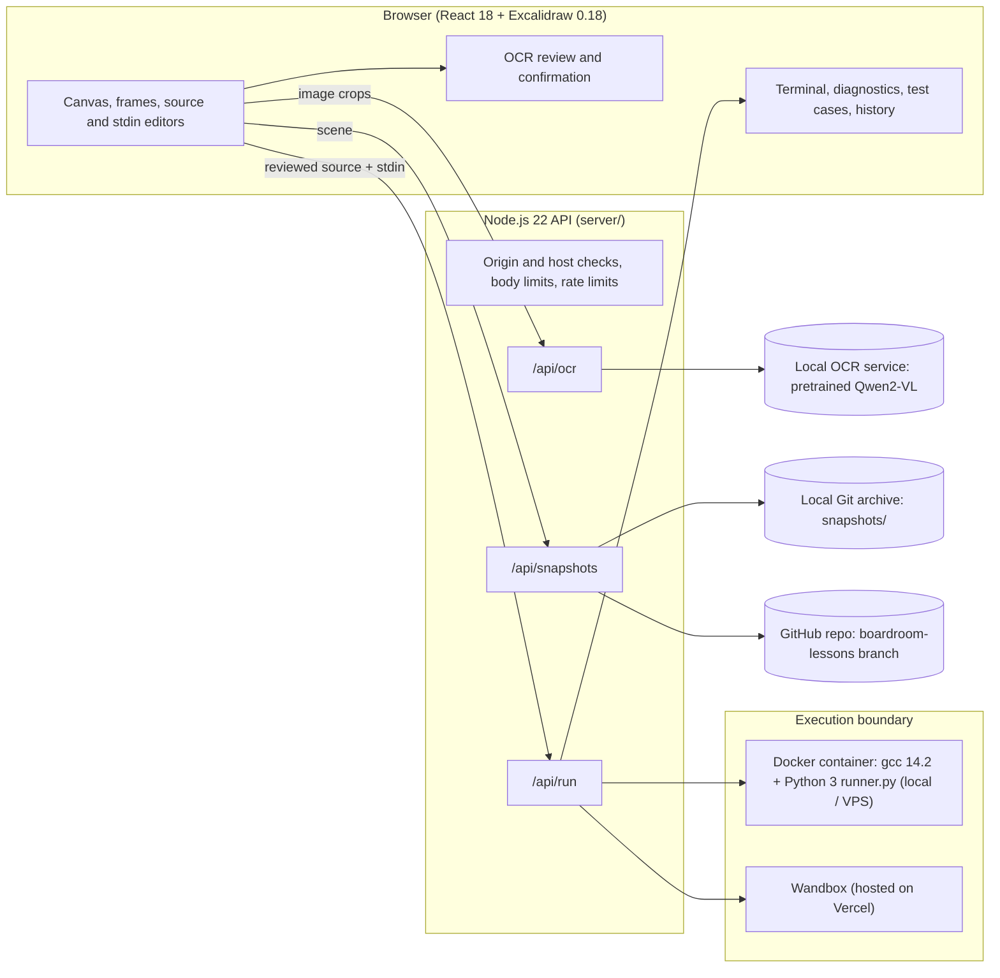

# Boardroom: the Executable Whiteboard

Boardroom turns a digital whiteboard into a live, verifiable coding classroom. A teacher writes or types C++ or Python on an [Excalidraw](https://excalidraw.com) canvas, selects the code region, supplies program input in blue ink, and runs it. The real compiler output, runtime errors and memory-safety reports appear next to the board and point back to the lines that caused them. No IDE switch is needed.

**Live app:** https://board-of-c.vercel.app · **App source:** [`whiteboard-code-verifier/`](whiteboard-code-verifier/)

---

## Contents

1. [Problem and user](#1-problem-and-user)
2. [Pitch: the idea, end to end](#2-pitch-the-idea-end-to-end)
3. [Product requirements (PRD)](#3-product-requirements-prd)
4. [How it works](#4-how-it-works)
5. [Architecture](#5-architecture)
6. [Data and AI used](#6-data-and-ai-used)
7. [Security and responsible use](#7-security-and-responsible-use)
8. [Tools and services used](#8-tools-and-services-used)
9. [How to run it](#9-how-to-run-it)
10. [Testing](#10-testing)
11. [AI tools and reused code](#11-ai-tools-and-reused-code)
12. [Limits](#12-limits)
13. [Repository layout and documentation](#13-repository-layout-and-documentation)

---

## 1. Problem and user

**User:** a teacher (school, college or bootcamp) who explains programming on a whiteboard.

**Problem:** code taught on a whiteboard is never executed.

- Students take it on trust, and the teacher's slips (a missing `&` in `scanf`, an off-by-one, a dangling pointer) surface late or never.
- Abstract ideas such as `malloc()` stay abstract because nothing real is shown.
- Retyping the board into an IDE breaks the flow of the lecture.

**Goal:** make classroom examples *verifiable*: show that working code works, expose mistakes honestly, and keep a versioned record of every lesson.

## 2. Pitch: the idea, end to end

> *"Write it on the board. Run it on the board."*

| Step | What happens | Who does the work |
|---|---|---|
| 1. **Write** | Teacher writes freehand or types on the canvas. Black ink is source code, blue ink is stdin. | Browser (React + Excalidraw) |
| 2. **Read** | Handwriting is read by a **pretrained vision-language model (Qwen2-VL) running locally** into separate `code` and `stdin` lines. It is told to transcribe literally and never "fix" the teacher's mistakes. | Backend + local OCR service |
| 3. **Confirm** | The teacher edits and explicitly confirms the transcription. Nothing runs unreviewed. | Browser |
| 4. **Run** | Source is compiled (g++ with sanitizers) or interpreted (Python 3) inside a locked-down, network-less container. | Backend, Docker (or Wandbox when hosted) |
| 5. **Explain** | stdout, stderr, compiler errors, ASan/UBSan reports and rule-based teaching notes (e.g. what `malloc` just did) are returned and linked to board lines. | Backend, runner |
| 6. **Test** | Up to 20 input cases run in sequence, each with an expected status and output. | Browser + backend |
| 7. **Archive** | Every run is saved as a dated Git commit holding the board, source, input, and a replay bundle. | Backend, Git / GitHub |
| 8. **Replay** | A teacher or student can re-open a past lesson or re-run its frozen build, even years later. | Git history + pinned Docker image |

**Backend implementation, end to end.** A single Node.js API fronts a local OCR model, an isolated runner and a Git archive, and keeps every secret server-side:

1. `POST /api/ocr` sends image crops to the local **OCR service** (`ocr-service/`, Qwen2-VL) and returns an unconfirmed transcription. No image leaves the machine.
2. `POST /api/run` hands reviewed source to an **isolated runner**. Locally this is a throwaway Docker container; on the hosted Vercel deployment it is a configured **Wandbox** service.
3. `POST /api/snapshots` commits the lesson to a **Git archive**, either on disk or in a GitHub repository through the Git Data API.

The models only read and suggest; **GCC and the runtime tools decide**. The AI never judges whether a program is correct.

**Why it is different from an online IDE:** it works at the speed of a lecture, directly on handwriting, and it makes the teacher's own mistakes visible instead of hiding them.

## 3. Product requirements (PRD)

The full document is in **[docs/PRD.md](docs/PRD.md)**, and a plain-language walkthrough of the whole project is in **[docs/PROJECT_REPORT.md](docs/PROJECT_REPORT.md)**. Summary:

| | |
|---|---|
| **Vision** | Every example shown on a board can be run, trusted and revisited. |
| **Primary user** | Programming teachers; secondary: students reviewing lessons. |
| **Must have (shipped)** | Canvas with code/stdin regions; pretrained local vision-model (Qwen2-VL) handwriting OCR with mandatory review; C++17 and Python execution; real diagnostics linked to the board; test cases; Git-backed lesson history. |
| **Should have (shipped)** | Teaching notes for `malloc`/`free`/`scanf` etc.; curated teaching libraries (`stack.h`, `linked_list.h`, `queue.h`, `search.h`). |
| **Non-goals** | Physical-whiteboard camera capture, user accounts, grading, running untrusted public code at scale. |
| **Success measures** | A teacher goes from handwriting to a real result in under a minute; compiler errors are linked to the right line; no OCR output runs without confirmation. |

## 4. How it works

1. **Select code & input.** Drag a frame around existing writing. Black ink is source; blue (`#1971c2`) ink is stdin; other colours are annotations and are ignored.
2. **Typed text bypasses OCR.** Typed elements are read literally, with blank lines preserved and a source-line-to-element map for diagnostics.
3. **Handwriting goes through the local Qwen2-VL model, then through the teacher.** Code and stdin are exported as separate PNG crops. The transcription is shown line by line with uncertainty flags. The teacher must tick both confirmations before it can be used.
4. **Run.** The runner compiles with `-std=c++17 -g -O0 -Wall -Wextra -fsanitize=address,undefined`, feeds stdin through a pipe and returns structured diagnostics. Code is run exactly as written; nothing is completed or corrected for the teacher.
5. **Snapshots and History.** Each completed run is archived; the History tab lists the latest 30 and restores the scene. Restored handwriting must be reviewed again.

Full details: [Technical stack and project overview](whiteboard-code-verifier/docs/technical-overview.md).

## 5. Architecture



### Deployment modes

| Mode | Frontend | API | Code execution | Lesson archive |
|---|---|---|---|---|
| **Local** | Vite dev server | `node server/index.mjs` on loopback | Local Docker (`whiteboard-runner:local`) | Git repo in `snapshots/` |
| **Docker API server** | Vercel | VPS behind Caddy (HTTPS) | Docker on the VPS | Disk Git archive, optional push to GitHub |
| **Vercel serverless** | Vercel | Vercel Functions in `api/` | Wandbox | GitHub Git Data API |
| **Railway** | Same container | `Dockerfile` + `railway.json` | As configured | As configured |

Design decisions worth noting:

- **Backend owns secrets and coordination; the container owns execution; the OCR model only transcribes.** No component is trusted with more than it needs.
- **No database.** The working board lives in browser state; durable history is Git, which gives diffs, authorship and offline replay for free.
- **No Express and no AI SDK.** The API uses Node's built-in `http` and `fetch`, which keeps the dependency surface and supply-chain risk small.
- **Reproducible replay.** Snapshots vendor the headers they use, freeze `runner.py` and the compiler flags, and record SHA-256 hashes plus a pinned GCC image reference.

## 6. Data and AI used

| Item | Detail |
|---|---|
| **OCR model** | Pretrained **Qwen2-VL 2B Instruct** (Alibaba Qwen, Hugging Face, Apache-2.0), run locally in `ocr-service/` with PyTorch on CPU. No training or fine-tuning was done. |
| **How it reads a board** | The whole crop goes to the model with a fixed prompt: transcribe literally, one line per written line, keep indentation, never repair code. The output is split into lines, and a line is flagged `uncertain` when its least-confident token is below 0.5. |
| **Why this model** | We were asked to use a pretrained model instead of an API. We first tried **TrOCR** (a line-level handwriting model); it misread code badly (`#include <iostream>` became `7in close , by no stream ?`) because it is trained on prose. A pretrained vision-language model reads code symbols and indentation correctly without any fine-tuning. The word-level [mltu IAM tutorial](https://github.com/pythonlessons/mltu/tree/main/Tutorials/03_handwriting_recognition) was also considered but trains from scratch on English words. See [OCR options](whiteboard-code-verifier/docs/ocr-options.md). |
| **What the AI does not do** | It does not decide correctness, grade, or run code. Execution evidence comes from GCC, sanitizers and the Python interpreter. |
| **Safeguards** | The prompt forbids adding missing headers, `&` or semicolons; transcription is editable and must be confirmed; scene fingerprints invalidate confirmation when ink changes. |
| **Data leaving the machine** | None for handwriting: images are processed by the local model and no AI API key exists in the project. |
| **Datasets** | None required. Test inputs are synthetic (`tests/fixtures`, built-in starter lessons). |

## 7. Security and responsible use

Running strangers' code is the hardest part of this project, so the layers are explicit.

### Code execution isolation (local Docker runner)

Every request gets a fresh container that is removed afterwards:

| Control | Setting |
|---|---|
| Network | `--network none` |
| Filesystem | `--read-only` root; 64 MiB `tmpfs` at `/tmp`; no host mounts |
| Privileges | `--cap-drop ALL`, `no-new-privileges`, user `65534:65534` (nobody) |
| Resources | 512 MiB memory (swap disabled), 1 CPU, 64 processes, `nofile=64`, 16 MiB max file size, no core dumps |
| Time | 10 s compile, 5 s run, 22 s outer kill, container force-removed after |
| Size | 32 KiB source, 8 KiB stdin, 16 KiB output |
| Runtime bugs | AddressSanitizer, UndefinedBehaviorSanitizer and leak detection |
| Includes | Only allowlisted teaching headers are served from the trusted library path |

### API and secrets

- **Secrets stay server-side.** The `SNAPSHOT_GITHUB_TOKEN` is never `VITE_`-prefixed, never mounted into containers, and never logged. Logs omit images, transcriptions and raw provider errors.
- **Origin and host checks.** The API binds to loopback, validates `Host` and `Origin`, and allows CORS only for the configured `BOARDROOM_APP_ORIGIN`. Browser requests carry no credentials.
- **Abuse limits.** Per visitor address: 6 OCR and 20 run requests per minute, plus a server-wide cap (30 and 120) so a crowd cannot overload the machine. OCR allows 1 request in flight (4 MiB body); runs allow 2 in flight (64 KiB body). Request and header timeouts are 10 s. Behind a reverse proxy set `BOARDROOM_TRUST_PROXY=1` so visitors are told apart.
- **Safe errors.** Responses carry diagnostic metadata only; quota failures are classified without leaking provider payloads.

### Responsible use

- **Human in the loop:** handwriting is never executed until the teacher confirms it.
- **Honest transcription:** the OCR model transcribes what is written and cannot repair mistakes, because hiding them would defeat the verifier.
- **Privacy:** no accounts, no database, no analytics; boards leave the browser only to reach your own API (local OCR, run, snapshot); handwriting is never sent to a third-party AI.
- **Integrity of history:** frozen replay bundles carry SHA-256 hashes; a hash mismatch is reported before anything is built.
- **Accessibility:** typed input is a full alternative to handwriting; the side panel is keyboard-resizable.

> **Honest caveat.** The hosted Vercel mode runs code on third-party Wandbox, so the sanitizer and resource claims above describe the Docker runner only. The API is currently public and has no login; process-local rate limits reset on restart. Opening it to arbitrary public traffic would need per-user authentication, shared rate limiting, and a stronger isolation design (e.g. gVisor or Firecracker).

## 8. Tools and services used

### Languages and frameworks

| Tool | Version | Why it is used |
|---|---|---|
| **JavaScript (ES modules) / JSX** | n/a | Frontend and API, one language across the stack |
| **React + React DOM** | 18.3.1 | UI components and state |
| **Excalidraw** (`@excalidraw/excalidraw`) | 0.18.0 | Whiteboard: freehand strokes, text, frames, canvas export |
| **Vite** | 8.2.2 | Dev server, API proxy, production build |
| **Node.js** | 22.12+ | API runtime, built-in `http`, `fetch`, `node:test` |
| **Python 3** | stdlib (runner); 3.12 (OCR) | In-container runner: compile, deadlines, diagnostics; snapshot replay; OCR service |
| **PyTorch + Hugging Face Transformers** | torch 2.2+, transformers 4.45+ | Runs the pretrained Qwen2-VL handwriting model |
| **Pillow + NumPy** | 10+ / 1.26+ | Image decoding and size checks before OCR |
| **Plain CSS** | n/a | Responsive layout, no UI framework |

### Execution and testing

| Tool | Why it is used |
|---|---|
| **Docker Engine** | Per-request isolated sandbox |
| **GCC 14.2 (`gcc:14.2.0-bookworm`)** | C++17 compiler image, with ASan/UBSan |
| **Node test runner + Python `unittest`** | Unit and integration tests |
| **Playwright 1.64.1** | Browser end-to-end tests |

### External services

| Service | Role | Where configured |
|---|---|---|
| **Qwen2-VL on Hugging Face** (`Qwen/Qwen2-VL-2B-Instruct`) | Pretrained handwriting model; weights downloaded once (~4.5 GB), then run offline | `OCR_MODEL`, `OCR_SERVICE_URL` |
| **Wandbox** | Hosted C++/Python execution when Docker is unavailable | `WANDBOX_API_URL`, `WANDBOX_CPP_COMPILER`, `WANDBOX_PYTHON_COMPILER` |
| **GitHub (Git Data API)** | Persistent lesson archive in hosted mode | `SNAPSHOT_GITHUB_REPOSITORY`, `SNAPSHOT_GITHUB_BRANCH`, `SNAPSHOT_GITHUB_TOKEN` |
| **Vercel** | Frontend hosting and serverless Functions (`api/`) | `vercel.json` |
| **Railway** | Alternative container hosting | `railway.json`, `Dockerfile` |
| **Caddy** (self-hosted option) | HTTPS reverse proxy in front of the Docker API | See [Docker API deployment](whiteboard-code-verifier/docs/docker-api-deployment.md) |

### Version control

| Tool | Use |
|---|---|
| **Git** | Version control for the code and for lesson snapshots |

## 9. How to run it

**Prerequisites:** Node.js 22.12+, and a Linux Docker daemon (Docker Desktop is fine) for local execution.

```bash
git clone https://github.com/NOTtaLEMON/Whiteboard-Project.git
cd Whiteboard-Project/whiteboard-code-verifier
npm ci
npm run runner:build     # builds the whiteboard-runner:local image
npm run dev
```

For handwriting, start the local OCR service in a second terminal (the first start downloads the pretrained weights, about 4.5 GB):

```bash
cd whiteboard-code-verifier/ocr-service
pip install -r requirements.txt
python service.py
```

Open http://127.0.0.1:5173. Typed code works without the OCR service. See [ocr-service/README.md](whiteboard-code-verifier/ocr-service/README.md).

| Command | Purpose |
|---|---|
| `npm run dev` | Frontend and API together |
| `npm run build` / `npm start` | Production build and API server |
| `npm test` | Node and Python unit tests |
| `npm run test:docker` | Check the container runner |
| `npm run test:browser` | Playwright end-to-end tests |
| `npm run test:ocr -- image.png` | OCR smoke test on a PNG (needs the OCR service running) |

**Environment variables** (see [`.env.example`](whiteboard-code-verifier/.env.example)):

| Variable | Purpose |
|---|---|
| `OCR_SERVICE_URL` | Where the API finds the OCR service (default `http://127.0.0.1:8788`; required on Vercel) |
| `OCR_MODEL` | Vision-language checkpoint (default `Qwen/Qwen2-VL-2B-Instruct`) |
| `OCR_TIMEOUT_MS` | API wait for the OCR service (default 180000 locally, 50000 on Vercel) |
| `SNAPSHOT_DIR` | Location of the local Git archive |
| `SNAPSHOT_GITHUB_*` | Hosted archive repository, branch, token |
| `BOARDROOM_APP_ORIGIN` | Allowed frontend origin for a separate API server |
| `WANDBOX_*` | Hosted execution endpoint and compilers |
| `VITE_BOARDROOM_API_ORIGIN` | Frontend build variable pointing at a remote API (public hostname only) |

**Deploy:** [Vercel serverless](whiteboard-code-verifier/docs/vercel-serverless.md) · [Docker API server](whiteboard-code-verifier/docs/docker-api-deployment.md) · Railway via the root `Dockerfile` (exposes port 8787).

## 10. Testing

- Unit tests cover board extraction, OCR parsing, hosted runner, snapshots, GitHub archive and test-case handling (`tests/*.test.mjs`, `tests/test_*.py`).
- `scripts/check-runner.mjs` exercises the real container sandbox; Playwright covers the browser flow.
- `npm run test:ocr -- image.png` reads a PNG through the running OCR service; `npm run benchmark:ocr` measures transcription error on private samples. See [OCR options](whiteboard-code-verifier/docs/ocr-options.md) for the models compared.

## 11. AI tools and reused code

**AI tools used in building:** Claude Code (Anthropic) for development assistance. **AI inside the product:** a pretrained Qwen2-VL model for handwriting, run locally with no API key, as described in [section 6](#6-data-and-ai-used).

**Reused open-source code and services:** Excalidraw, React, Vite, Playwright, the GCC Docker image, the pretrained Qwen2-VL weights (via Hugging Face Transformers), and the third-party Wandbox API. Everything else, including the runner, sandbox orchestration, snapshot/replay system, teaching libraries and OCR review flow, is original to this project.

## 12. Limits

- **Languages:** C++17 and Python 3 only. Early designs targeted plain C; some filenames and docs still say "C".
- **OCR:** The pretrained model is not trained on classroom handwriting, and uncertainty flags are not calibrated scores; it was verified on one hand-drawn sample, not benchmarked. Teacher review is mandatory by design. OCR returns text without line coordinates, so handwritten diagnostics appear in the editor rather than on the canvas.
- **OCR hosting and speed:** the model needs about 4.5 GB of disk and roughly 10 GB of RAM, and takes about 30 seconds per read on a laptop CPU (seconds with a GPU). It runs as a local or Docker service; Vercel cannot host it, so set `OCR_SERVICE_URL` to a server that can.
- **Isolation:** sanitizers and resource limits apply to the Docker runner, not to Wandbox. See the security caveat above.
- **Interactivity:** programs receive stdin as a single pipe; there is no interactive terminal.
- **Persistence:** no accounts or database; the working board is held in the browser until saved or downloaded.
- **Memory teaching:** the memory demonstration visualises addresses printed by the program, not arbitrary process memory.
- **Out of scope:** physical-whiteboard camera capture, grading, library semver management.

## 13. Repository layout and documentation

```text
.
├── README.md                     This file
├── docs/PRD.md                   Product requirements document
├── Dockerfile, railway.json      Container build and Railway deployment
└── whiteboard-code-verifier/     The application
    ├── src/                      React UI, board extraction, capture, review
    ├── server/                   Node API, OCR client, sandbox, snapshots
    ├── api/                      Vercel serverless entry points
    ├── runner/                   Runner Dockerfile, runner.py, teaching headers
    ├── ocr-service/              Local pretrained Qwen2-VL handwriting service (Python)
    ├── scripts/                  Dev launcher, smoke checks, benchmarks
    ├── tests/                    Unit, integration and browser tests
    └── docs/                     Technical documentation
```

| Document | Contents |
|---|---|
| [Project report](docs/PROJECT_REPORT.md) | Plain-language explanation of the PRD, the whole project, the tools used and the security measures |
| [PRD](docs/PRD.md) | Requirements, scope, user stories, acceptance criteria |
| [Application README](whiteboard-code-verifier/README.md) | Feature list and setup |
| [Technical overview](whiteboard-code-verifier/docs/technical-overview.md) | Full architecture, limits, API reference |
| [OCR options](whiteboard-code-verifier/docs/ocr-options.md) | Model choice and comparison |
| [OCR service](whiteboard-code-verifier/ocr-service/README.md) | Local OCR service setup and limits |
| [C libraries](whiteboard-code-verifier/docs/c-libraries.md) | Teaching header APIs |
| [Vercel deployment](whiteboard-code-verifier/docs/vercel-serverless.md) | Serverless setup |
| [Docker API deployment](whiteboard-code-verifier/docs/docker-api-deployment.md) | VPS setup |
| [Original notes](whiteboard-code-verifier.md) | Concept and design history |
